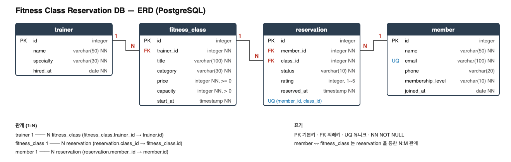

# 피트니스 센터 수업 예약 DB

SQL만으로 **데이터 모델링 → 데이터 입력 → 요구사항을 쿼리로 해결**하는 전체 흐름을 실습하는 미션입니다. (백엔드 프레임워크 없이, PostgreSQL + SQL만 사용)

회원이 트레이너가 진행하는 수업을 예약하고, 출석한 뒤 평점을 남기는 피트니스 센터를 주제로 했습니다.

## 데이터 모델



| 테이블 | 설명 | 행 수 |
|---|---|---|
| `member` | 회원 (등급: BASIC / PREMIUM / VIP) | 12 |
| `trainer` | 트레이너 (전문 분야) | 10 |
| `fitness_class` | 특정 일시에 열리는 1회 수업 | 15 |
| `reservation` | 회원의 수업 예약 (상태, 평점) | 30 |

**관계 (1:N 3개)**
- `trainer` 1 : N `fitness_class`
- `member` 1 : N `reservation`
- `fitness_class` 1 : N `reservation`

`member`와 `fitness_class`는 `reservation`을 통한 N:M 관계입니다.

**제약조건**: PK, FK, NOT NULL, UNIQUE(`member.email`, `reservation(member_id, class_id)`), CHECK(가격·정원·평점·상태값)

## 폴더 구조

```
.
├── sql/
│   ├── 01_schema.sql        # 테이블 생성 (PK/FK/제약조건)
│   ├── 02_seed.sql          # 샘플 데이터 INSERT
│   ├── 03_queries.sql       # 핵심 쿼리 15개 + 인덱스
│   └── demo_fk_error.sql    # (발표용) FK·UNIQUE·CHECK 위반 시연
├── results/                 # 쿼리 실행 결과
├── docs/                    # ERD (png / svg / dbml)
├── docker-compose.yml       # PostgreSQL 16
├── .env.example             # DB 접속 정보 템플릿
├── PLAN.md                  # 작업 계획
├── RUN_GUIDE.md             # 실행 결과 만드는 단계별 가이드
├── defense.md               # 평가 대비 설명 자료
└── deep-dive.md             # 심화 이론 학습 자료
```

## 실행 방법

### 1. 준비
- [Docker](https://www.docker.com/products/docker-desktop/) (Docker Desktop 등)
- Docker 없이 실행하려면 [RUN_GUIDE.md](RUN_GUIDE.md)의 "방법 B (Homebrew)"를 참고하세요.

### 2. DB 실행
```bash
cp .env.example .env
docker compose up -d
docker compose ps        # STATUS가 healthy가 될 때까지 대기
```
최초 기동 시 `01_schema.sql`과 `02_seed.sql`이 자동으로 실행됩니다.

### 3. 접속
```bash
docker compose exec db psql -U fitness -d fitness_db
```
DBeaver, TablePlus 등 외부 도구에서는 `localhost:5432` / DB `fitness_db` / 계정 `fitness` / 비밀번호는 `.env`를 참고하세요.

### 4. 쿼리 실행
```bash
# 쿼리 15개 실행하고 결과 저장 (데이터를 바꾸므로 한 번만 실행)
docker compose exec -T db psql -U fitness -d fitness_db -e < sql/03_queries.sql > results/02_queries_all.txt 2>&1

# FK 에러 시연 (데이터를 바꾸지 않아 반복 실행 가능)
docker compose exec -T db psql -U fitness -d fitness_db -e < sql/demo_fk_error.sql
```

### 5. 처음 상태로 초기화
```bash
docker compose down -v && docker compose up -d
```
초기화 스크립트는 DB 볼륨이 비어 있을 때만 실행되므로, SQL 파일을 수정했거나 `03_queries.sql`을 이미 실행했다면 위 명령으로 다시 적재합니다.

## 핵심 쿼리 15개

| 범주 | 쿼리 |
|---|---|
| 기본 조회 | Q1 VIP 회원 목록, Q2 가장 비싼 수업 TOP 5, Q3 최근 30일 수업, Q4 이름 검색(LIKE) |
| 조인 | Q5 수업+트레이너, Q6 예약 내역(3개 테이블), Q7 트레이너별 수업 수(LEFT JOIN), Q8 회원별 예약(LEFT JOIN) |
| 집계 | Q9 회원별 예약 수, Q10 트레이너별 출석 매출, Q11 카테고리별 평균 평점(HAVING) |
| 서브쿼리 | Q12 예약이 없는 회원 (NOT EXISTS) |
| 수정·삭제 | Q13 지난 수업의 미출석 예약 → NO_SHOW, Q14 취소된 예약 삭제 |
| 인덱스 | Q15 `reservation(class_id)` 인덱스 |

쿼리마다 `-- [Qn]` 형태의 한 줄 설명 주석이 있고, PostgreSQL 전용 문법(`LIMIT`, `INTERVAL`, `EXPLAIN`)에는 별도 주석을 달았습니다.

## 참고 사항
- Q3은 `CURRENT_DATE` 기준이라 실행하는 날짜에 따라 결과가 달라집니다.
- 데이터가 30행 수준이라 Q15의 인덱스를 만든 뒤에도 `EXPLAIN`은 Seq Scan으로 나올 수 있습니다. (옵티마이저가 전체 스캔이 더 싸다고 판단한 정상 동작)
- View, Procedure, Trigger는 사용하지 않았습니다.


